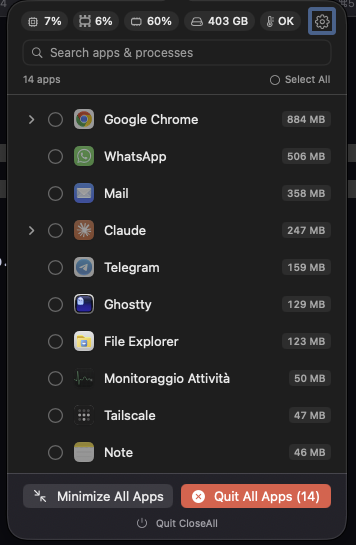

# CloseAll - macOS Menu Bar App

CloseAll is a lightweight macOS menu bar app that lets you quit all running applications with a single click, with real-time system monitoring (memory, CPU, GPU, disk, thermal).



## Install

1. Download `CloseAll.dmg` from the [latest release](https://github.com/Swallow74/closeall/releases/latest) and drag **CloseAll** to Applications.
2. Requires macOS 12+ on Apple Silicon. English and Italian, following the system language.
3. Updates: a banner in the popover offers **Install & Restart** when a new release is out (Settings → About → Check for updates).

## Project Structure

```
closeall/
├── Sources/
│   ├── main.swift                  # Entry point (manual NSApplication.run)
│   ├── AppDelegate.swift           # App delegate, setup StatusBarController
│   ├── AppSettings.swift           # UserDefaults-backed settings
│   ├── AppConstants.swift          # All constants: strings, keys, dimensions
│   ├── MemoryPressureManager.swift # System memory monitoring (host_statistics64)
│   ├── ThermalStateManager.swift   # Thermal state monitoring (ProcessInfo)
│   ├── DiskSpaceManager.swift      # Free disk space monitoring
│   ├── CPUManager.swift            # Global + per-app CPU usage monitoring
│   ├── GPUManager.swift            # GPU utilization monitoring (IOKit)
│   ├── GPUIconHelper.swift         # Custom drawn GPU status bar icon
│   ├── ProcessManager.swift        # Logic: app list, quit, force quit, ignore
│   ├── KeyboardShortcutManager.swift # Global hotkeys via Carbon RegisterEventHotKey
│   ├── ProcessScanner.swift        # libproc scan: memory, CPU time, parent PID
│   ├── LoginItemsManager.swift     # Launch at login (SMAppService)
│   ├── Models/
│   │   └── AppInfo.swift           # Model for listed apps
│   └── Views/
│       ├── StatusBarController.swift   # NSStatusItem + NSPopover
│       ├── PopoverContentView.swift    # Main SwiftUI view
│       ├── SettingsView.swift          # Settings page
│       ├── Components.swift            # Chips, badges, tooltips, confirm dialogs
│       └── AppRowView.swift            # App and process rows
├── Resources/
│   ├── Info.plist                  # LSUIElement=YES (hides from Dock)
│   └── it.lproj/                   # Italian localization (English is the source)
├── project.yml                     # XcodeGen config
└── SPEC.md                         # Technical specification
```

## Build & Run

```bash
xcodegen generate --spec project.yml
xcodebuild -project CloseAll.xcodeproj -scheme CloseAll -destination 'platform=macOS,arch=arm64' build
```

The built app will be automatically copied to `/Applications/CloseAll.app`.

## Features

| Feature | Description |
|---------|-------------|
| **Quit All** | Closes all running apps at once |
| **Minimize All** | Hides all apps without closing them |
| **Keyboard Shortcuts** | `⌃⌥⌘Q` quit all, `⌃⌥⌘M` minimize all — work even with icon hidden |
| **Quit Selected** | Check apps, quit only those |
| **Force Quit** | Force close stubborn apps |
| **Ignore Apps** | Keep apps out of the list (Finder always ignored) |
| **Search** | Find running apps by name |
| **Hide Menu Icon** | Background-only mode, shortcuts still work |
| **Launch at Login** | Auto-start with your Mac |
| **Memory Pressure Monitor** | Real-time free RAM %, colored indicator + banner + critical alert + per-app resident memory shown in app list sorted by usage |
| **CPU Monitor** | Global CPU % + per-app CPU usage shown in app list |
| **GPU Monitor** | GPU utilization % via IOKit AGXAccelerator, custom status bar icon |
| **Disk Space Monitor** | Free disk space GB/%, warning when below threshold |
| **Thermal State Monitor** | Tracks system thermal state (fair/serious/critical) |
| **Process Groups** | Shows child processes under each app with resident memory, expandable/collapsible |
| **Orphan Processes** | Lists non-system processes > 100 MB not tied to a visible app |
| **Auto-Free Memory** | When memory critically low, auto-quits background apps to free RAM |
| **System Tray Icon** | Changes icon/color based on most critical system condition, tooltip shows all states |
| **No Dock Icon** | Runs silently in the menu bar |
| **Update Notifications** | Checks GitHub for new releases and shows download banner |
| **Non-blocking quit** | Quits run in parallel without freezing the UI; apps that refuse are listed with a one-click Force Quit |
| **Row context menu** | Right-click an app: show, hide, reveal in Finder, protect, ignore, quit, force quit |
| **Localized** | English and Italian, follows the system language |
| **Zero Dependencies** | Pure Swift, no external libraries |

## Interactions

- **Left-click icon**: opens the app popover
- **Right-click icon**: quick actions (Minimize All, Quit All, Settings)
- **Click an app row**: select it for batch actions
- **Right-click an app row**: context menu (show, hide, reveal, protect, ignore, quit)
- **Reopen CloseAll** from Spotlight/Finder: opens the popover, even with the menu icon hidden
- **Hover on an app row**: shows quit and ignore buttons, plus CPU usage if > 5%
- **Hover on a process row**: shows terminate and force kill buttons with tooltips
- **Per-app memory**: resident memory shown as `X MB` or `X.X GB` next to each app, apps sorted by memory usage descending
- **× button**: close the app gently
- **⚡ button**: force close unresponsive apps
- **⌃⌥⌘Q**: quit all apps instantly
- **⌃⌥⌘M**: minimize all apps instantly

## Settings

- **Keyboard shortcuts**: enable/disable global shortcuts
- **Require confirmation**: confirmation dialog before Quit All
- **Hide menu icon**: hide from menu bar (shortcuts still work)
- **Memory pressure monitoring**: enable/disable memory monitor (on by default)
- **GPU monitoring**: enable/disable GPU monitor (off by default)
- **Thermal state monitoring**: enable/disable thermal monitor (off by default)
- **Disk space monitoring**: enable/disable disk space monitor (off by default)
- **CPU monitoring**: enable/disable CPU monitor (off by default)
- **Auto-free memory**: auto-quit background apps when memory is low (off by default)
- **Memory / disk thresholds**: choose when the warnings trigger
- **Launch at login**: auto-start with your Mac (macOS 13+: registered via SMAppService)

## Monitoring Levels

Thresholds: the memory warning level (10–30%) and the disk warning level (5–100 GB) are configurable in Settings → Monitors. Values below are the defaults.

### Memory Pressure
| Level | Free Memory | Indicator |
|-------|-------------|-----------|
| Normal | > 20% | Green dot in header, standard menu bar icon |
| Warning | 10–20% | Orange dot, yellow triangle in menu bar |
| Critical | < 10% | Red dot, red octagon in menu bar |

### GPU Usage
| Level | Usage | Indicator |
|-------|-------|-----------|
| Normal | < 70% | White label, default icon |
| Warning | 70–90% | Orange label, orange icon in menu bar |
| Critical | > 90% | Red label, red icon in menu bar |

### CPU Usage
| Level | Usage | Indicator |
|-------|-------|-----------|
| Normal | < 80% | Green label |
| Warning | 80–95% | Orange label, orange CPU icon in menu bar |
| Critical | > 95% | Red label, red CPU icon in menu bar |

### Disk Space
| Level | Free Space | Indicator |
|-------|------------|-----------|
| Normal | > 10 GB | Green indicator |
| Warning | 5–10 GB | Orange indicator, disk icon in menu bar |
| Critical | < 5 GB | Red indicator |

### Thermal State
| Level | State | Indicator |
|-------|-------|-----------|
| Normal | Nominal/Fair | Green indicator |
| Warning | Serious | Orange indicator, thermometer icon in menu bar |
| Critical | Critical | Red indicator |

### Tooltip
The status bar icon tooltip shows a multi-line summary of all active monitors:

```
Memory: 45% free
Disk: 73% free
Thermal: Normal
CPU: 23%
```

Warning states are prefixed with ⚠ and shown in priority order.
